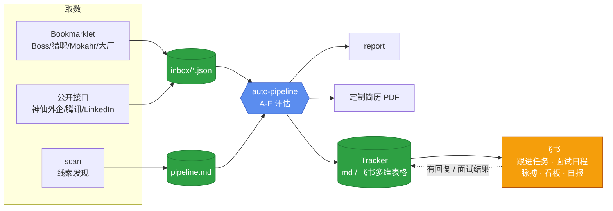

# career-ops-china

> 把 Claude Code 变成国内求职指挥中心 —— **一个过滤器，不是海投炮**。

贴一个 JD 进来，AI 跑完 A-F 六块评估、生成定制简历 PDF、写进投递追踪；投出去之后，飞书负责提醒你跟进、记录每一轮面试、在回复率异常时叫你停下来复盘。

基于 [`santifer/career-ops`](https://github.com/santifer/career-ops)（MIT）深度改造，面向中国大陆的 AI / 数据 / 后端 / 平台方向求职者。换方向只需要跟 Claude 说一句，见 [docs/MODES.md](docs/MODES.md#换方向)。

---

## 三个亮点

### ① Bookmarklet + 本地 Inbox：国内 JD 取数的正解

Boss 直聘、猎聘、拉勾、Mokahr、大厂 careers SPA 都有反爬、反复制和登录墙，Playwright / WebFetch 在这些平台上基本拿不到 JD。但**你在浏览器里已经看到的页面，DOM 一直是能读的**。

```
打开 JD 页 → 点书签栏按钮 → localhost:8787 接收 → inbox/*.json → /career-ops inbox 批量评估
```

- 6 个 bookmarklet：通用 / Boss / 猎聘 / 拉勾 / Mokahr / 大厂 SPA，自动去掉反复制，按站点结构化抽取
- 有公开接口的渠道直接走接口：`npm run waiqi`（神仙外企）、`npm run tencent`、`npm run linkedin`
- `npm run apply-link` 投递前校验官网链接还在不在招（Workday / SmartRecruiters 走公开接口确认）
- 服务只监听 `127.0.0.1`，JD 只存在本地

→ [docs/JD-CAPTURE.md](docs/JD-CAPTURE.md)

### ② 飞书深度集成：投出去之后的事也有人管

表格里的 Status 不会提醒任何人。所以投递之后的流程交给飞书（通过 [lark-cli](https://github.com/larksuite/lark-cli)）：

| 能力 | 做什么 | 入口 |
|---|---|---|
| **多维表格 Tracker** | 投递追踪的唯一写源：看板、待投队列（按分数排序）、按方向分组视图、生命周期标签 | `npm run tracker:setup` |
| **跟进任务** | 投递后 +3 天提醒跟进，+14 天提醒结案；有回复后任务自动完成。每天定时对账 | `npm run followup` |
| **面试日程** | 告诉 Claude「进面试了」→ 它建好日程（描述里带 JD 摘要、公司调研、要问的问题），并挂一个提前 24h「过一遍简历」的任务；HR 问哪天有空时按忙闲推荐时段 | [modes/feishu.md](modes/feishu.md) |
| **投递脉搏** | 按渠道的历史回复曲线算出「到今天应该收到几个回复」，和实际比 → 🟩 正常 / 🟨 观察 / 🟥 暂停投递 | `npm run pulse` |
| **面试复盘** | 每一轮面试一行：轮次、形式、结果、面试官原话，自动回写最远阶段和出局阶段 | `npm run interview` |
| **漏斗看板** | 按方向（Track）分开算的转化漏斗，同步成多维表格仪表盘，手机上能看 | `npm run feishu:insights` |
| **每日摘要** | 机器人发到你的飞书私聊：该跟进的、高分没投的、脉搏信号 | `npm run feishu:digest` |
| **简历附件** | 把实际投出去的那版 PDF 挂到对应记录上，面试当天打开就能看到 | `tools/feishu/docs.mjs` |

**全部是可选插件**：`config/profile.yml` 里按能力单独开关，关掉后返回 skipped，提醒降级写到 `data/reminders.md`，核心流程不受影响。所有 lark-cli 调用都走 `tools/feishu/capabilities.mjs` 这一个入口，统一强制带 `--profile`（不会写到别的租户）、写操作用 `--as user`，并且永远不会自己加 `--yes`。`npm run feishu:check` 会分别检查开关、身份、scope 三层，告诉你是哪一层出了问题。

→ [docs/FEISHU.md](docs/FEISHU.md)

### ③ 按国内市场重写的评估 + 定制简历

- **A-F 六块评估**：角色摘要 / CV 逐条匹配 / 级别策略 / 薪酬与口碑（看准网、脉脉、OfferShow、知乎）/ 改简历建议 / STAR+R 面试故事
- **10 维加权评分**：薪资、工时、公司稳定性权重调高；去掉了「远程质量」这一维。低于 4.0/5 明确建议不投
- **硬红线**：你定义的 deal-breaker（外包、派遣、大小周……）在评估前直接 SKIP，不在不想去的岗位上浪费时间
- **多方向 Track**：几个求职方向并行时，评估、简历底稿和漏斗都按方向分开
- **简历防造假**：`cv.md` 是事实层，各方向的简历变体只能改写、不能新增事实；`npm run sync-check` 发现新增事实直接报错。国内大厂会做背调

→ [docs/EVALUATION.md](docs/EVALUATION.md)

---

## 工作原理



---

## 快速开始

```bash
git clone https://github.com/shuheng-mo/career-ops-china.git
cd career-ops-china
npm install && npx playwright install chromium
claude
```

在 Claude Code 里说一句「**帮我配置 career-ops-china**」，它会引导你建 `cv.md`、`config/profile.yml`，问你的目标方向、薪资和红线。完整步骤见 [docs/SETUP.zh.md](docs/SETUP.zh.md)。

## 常用操作

| 你想做 | 怎么做 |
|---|---|
| 评估一个岗位 | 直接贴 JD 文本 / 截图 / URL |
| 处理 bookmarklet 抓到的 JD | `/career-ops inbox` |
| 发现新岗位线索 | `/career-ops scan` |
| 改完简历 md 重新出 PDF | `npm run cv -- output/<file>.md` |
| 看投递情况和脉搏 | `/career-ops tracker`、`npm run pulse` |
| 查看全部命令 | `/career-ops`，或看 [docs/MODES.md](docs/MODES.md) |

## 设计原则

- **质量优先于数量**：5 份精准投递好过 50 份群发；低于 4.0 分会明确建议不投
- **最后一步永远由你来做**：系统可以填表、写回答、出 PDF，提交和发送按钮永远是你自己点
- **不爬反爬平台**：Boss / 拉勾 / 猎聘一律不做自动化抓取，只读取你自己打开的页面
- **文件就是配置，Claude 来改**：archetype、权重、红线、目标公司，说一句话就能改

## 文档

| 文档 | 内容 |
|---|---|
| [SETUP.zh.md](docs/SETUP.zh.md) | 安装、onboarding、cv.md / profile.yml / portals.yml 怎么写、隐私 |
| [EVALUATION.md](docs/EVALUATION.md) | A-F 评估、archetype、评分权重、红线、职级对标、国内求职提醒 |
| [JD-CAPTURE.md](docs/JD-CAPTURE.md) | 各平台的取数策略、bookmarklet 安装与原理、接口取数脚本 |
| [FEISHU.md](docs/FEISHU.md) | 飞书集成：多维表格后端、提醒、脉搏模型、面试表、看板、踩坑记录 |
| [MODES.md](docs/MODES.md) | 全部命令模式、使用示例、怎么让 Claude 帮你定制 |
| [FORK-NOTES.md](docs/FORK-NOTES.md) | 和上游的区别、从上游同步、目录结构 |
| [tools/README.md](tools/README.md) | bookmarklet 与本地 inbox 服务器的技术细节 |

`docs/ARCHITECTURE.md`、`docs/SETUP.md`、`docs/CUSTOMIZATION.md` 是上游英文原版，保留作参考，部分内容已过时。

---

## 致谢

- **[santifer](https://santifer.io)**：原版 [`career-ops`](https://github.com/santifer/career-ops) 的作者，用它评估了 740+ 个岗位，最终拿到 Head of Applied AI 的职位。配套的作品集 [cv-santiago](https://github.com/santifer/cv-santiago) 也是开源的。
- **Claude Code**：这个 fork 的定制几乎都是 Claude 自己写的。

## License

MIT，见 [LICENSE](LICENSE)。保留原作者 santifer 的版权。

---

## Star History

如果这个项目对你的求职有帮助，欢迎点个 ⭐，这是对持续维护最直接的鼓励。

<!-- star-history:start -->
<picture>
  <source media="(prefers-color-scheme: dark)" srcset="assets/star-history/star-history-dark.svg">
  
</picture>
<!-- star-history:end -->
