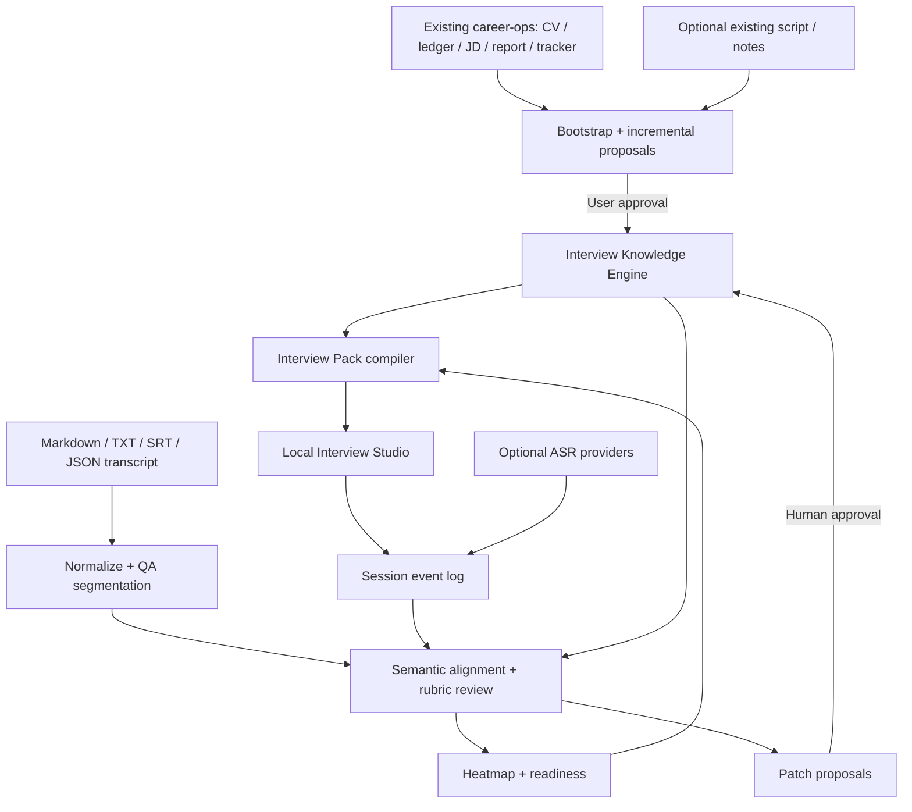

# career-ops-china · Interview Studio 实现规格 v0.2

> 状态：Ready for implementation（产品决策已定；供应商能力需实际 smoke test）  
> 日期：2026-11-24（北京时间）  
> 目标读者：Claude Code / 其他 SWE Agent  
> 范围：从面试知识库、企业面试包、转录回放到语义提词训练的完整闭环。  
> 对外定位：面向中国大陆求职者的本地优先面试工作台。**让每一次面试都成为下一次面试的训练数据。**

## v0.2 变更摘要（覆盖 v0.1 的冷启动假设）

- 面试知识库是产品在求职生命周期内构建的资产，不是用户必须事先准备的输入。逐字稿导入仅是可选加速路径。
- 新用户在 CV onboarding 完成后可选择初始化知识库；允许跳过、稍后继续。没有逐字稿、历史转录、JD、飞书或额外 API Key 也可以开始。
- Phase 1 必须同时验收 CV-only 冷启动与已有逐字稿迁移，并接入 JD/Block F 的增量候选信号；不可把冷启动留到 UI 或 ASR 阶段。
- 预测题、实际被问、练习表现、事实证据分别建模；模型只能提候选问题、待确认信息及受事实约束的答案草稿。
- ASR、China-first、Local-first、BYOK 及后续技术路线保持 v0.1 不变。

## 0. 给执行 Agent 的开工指令

先读本规格 §0–3、§11–13，再读现有仓库相关代码。本文所有新增路径、命令、阈值均为拟实现契约，不是现有功能。当前仓库与本文有差异时，先列差异和最小兼容方案，禁止覆盖用户文件或擅自迁移数据。按 Phase 0 → 1 → 2 → 3 → 4 执行，每个 Phase 独立 commit；当前轮只执行 Phase 0 和 Phase 1，完成验收后再开启后续阶段。不要一次性实现全部模块，不要顺手重构 Tracker、CV 或飞书。Phase 1 的第一条纵向切片必须以一份 CV（没有现成逐字稿、没有面试史）开始，形成首批可练习知识块；第二条再验证逐字稿导入和历史复盘。

- 先执行 `git status --short`、`git rev-parse HEAD`，记录基线；保留用户未提交的修改。检查当前 Node 版本、lockfile、已有测试、Skill 入口（从实际文件定位，不猜路径）。
- 阅读 `README.md`、`package.json`、`docs/MODES.md`、`modes/story-sync.md`、`modes/evolve.md`、`tools/cv-version.mjs`、`tools/cv-facts.mjs`、`tools/tracker-backend.mjs`、`tools/feishu/interviews.mjs`、`tools/feishu/capabilities.mjs`、`config/profile.example.yml`、`.gitignore`。检查 `git ls-files interview-prep cv-evolve` 是否已有被追踪的私密文件；如有，报告并等待用户决定如何处理，不自行改写历史。
- 用户输入的逐字稿、转录、面试报告、简历、事实账本均是私密数据；用户需自行将资料放入本地忽略目录。**绝不把本人 v2.6 逐字稿或真实面试录音做成公开 fixture。** 公共测试全部使用虚构案例。
- 每个阶段执行新增测试和相关既有回归测试；先核对 `package.json` 中已有命令，不把联网/需真实账户的命令当默认测试。记录 PASS/FAIL/SKIP、实际运行环境、证据文件；不虚报指标。
- 不修改真实申请状态、不发飞书消息、不创建真实云端热词表、不调用付费模型，除非用户显式选择相应操作。涉及安装、密钥、麦克风权限、付费 smoke test、事实审批的步骤由用户完成或确认。
- 新增实现必须有 `docs/INTERVIEW-STUDIO.md`、命令示例、中文错误提示、可复现的 synthetic demo。技术债和 ADR 记到 `docs/interview-studio/decisions.md`。

## 1. 产品目标与边界

### 1.1 四个核心能力

| 能力 | 用户问题 | 输出 |
|---|---|---|
| Interview Brain | 从零准备面试困难；已有逐字稿太长、重复、口径漂移 | 从 CV/日常求职材料逐步建立的可版本化知识块、问题索引、事实引用、热度与掌握度 |
| Interview Pack | 通用逐字稿 + 考前一页纸分离 | 按岗位、轮次、实际投递 CV、最新公司资料编译的面试包 |
| Interview Replay | 每次手工核对转录与逐字稿 | 原话证据、问题对齐、要点覆盖、口径漂移、新问题、演进提案 |
| Semantic Teleprompter | 模拟面试听到问题很难迅速找到知识锚点 | 实时转录、语义定位、锚点练习、盲测、可回放轨迹 |

新用户的首个价值时刻：不写逐字稿也能基于自己的 CV 确认至少一组真实项目故事与高优先级问题，得到可练习的答案锚点。

北极星指标：用户完成一次真实面试之后，能够在一次复盘流程中生成可追溯的改进清单，并将经本人批准的改动用于下一场面试；度量人工复盘耗时、准备耗时、盲测独立回答质量，而不以投递量或逐字稿长度作为成功标准。

### 1.2 不做清单（v0.2）

- 不做隐蔽悬浮窗、绕过面试平台检测、自动替人回答、实时生成标准答案；真实面试默认仅在取得必要同意且规则允许时录音/标记，默认不显示提示。完整提词只用于模拟训练或明确允许查阅材料的场景。
- 不做 SaaS、多用户、登录系统、收费、云数据库、向量数据库、知识图谱服务、自动录制所有系统音频、移动端 App、复杂 TTS 数字人。
- 不将 LLM 判分当真实招聘结果或能力认证；不预测通过概率，不因某次拒绝自动判定哪个答案导致失败。
- 不自动删除低频问题，不自动修改已确认事实、已投简历、历史会话版本；不自动把生成的假设/公司资料写入个人事实账本。

## 2. 现有仓库契约与集成

依据此前对 GitHub `shuheng-mo/career-ops-china` main 的读取（开工时重新核对 HEAD）：

| 现有资产 | 事实与集成策略 |
|---|---|
| `package.json` | Node ESM `.mjs`，已有 marked、playwright；新增功能按需引入依赖并锁版本，不强制全局 native 安装 |
| `modes/story-sync.md` | 从 report Block F、mock-interviews 提炼 STAR+R，生成 story-bank.md；作为知识库导入源/兼容投影，不新建一个无关联的故事库 |
| 现有 onboarding / auto-pipeline / batch | 从实际仓库定位入口；CV 初始化结束后一次性提供可跳过的知识库邀请；已启用时在 report 成功落盘后登记增量信号，失败不得影响原流程。batch 不由各 worker 并发写活动知识库 |
| `modes/evolve.md` | `cv.md` 为简历 canonical，`cv-evolve/ledger.yml` 记录证据等级、状态与来源；沿用审批、版本和 sync-check 纪律 |
| `tools/tracker-backend.mjs` | `listApplications()` 提供 num/company/role/track/report/pdf 等统一字段；不得直接依赖 Bitable 字段 |
| `tools/feishu/interviews.mjs` | `listRounds(num)`、既有 add/list/setup CLI，按轮次记录反馈并回写申请阶段；本模块不得因练习/导入自动调用 add |
| `config/profile.example.yml` | 增加 `interview` 配置示例；保留现有 YAML 注释与旧配置兼容，默认功能关闭/无额外网络 |
| `.gitignore` | `interview-prep/*` 已忽略；检查新增敏感路径和已追踪历史；公开模板放 `templates/interview/`，不是个人目录 |
| JD inbox server | 当前面向 bookmarklet 的开放 CORS；不复用其服务端口或权限模型作为面试工作台 |

现有 `npm run interview -- add/list/setup` 保持原语义。新增命令使用 `interview:*` npm 前缀和 `/career-ops interview-*` mode。既有用户不配置新功能时，原有安装与工作流不得改变。

## 3. 架构与技术决策（China-first / Local-first / BYOK）



### 3.1 选型矩阵（发布要求，而非性能结论）

| 层 | 首选 | 降级/可选 | 禁止硬依赖 |
|---|---|---|---|
| Runtime | Node.js ESM，建议 Node 22/24 LTS，具体最低版本与现有仓库兼容 | 无 native 模块的 CLI 仍可用 | Python 全局环境、Docker、GPU |
| 存储 | Markdown + YAML front matter + JSON/JSONL，原子写入、可导出 | 派生索引可重建 | PostgreSQL/Redis/Milvus |
| Markdown/YAML | 复用 marked；新增 `yaml` 解析（安全 schema、拒绝重复键/未知危险 tag） | 原文保留 | 正则解析任意嵌套 YAML |
| Schema | JSON Schema + Ajv 或仓库已有等价校验器，选择一个 | 无效文件隔离和诊断 | 仅靠 LLM 输出格式约定 |
| 检索 | 本地 NFKC/术语归一化、中文字符 bigram + 英文 token BM25；内存索引 | 可选向量 + RRF 融合 | 云 embedding 作为必需品 |
| Embedding | 无 Key 默认 lexical；配置后支持百炼 `text-embedding-v4`（中国内地） | 本地 OpenAI-compatible embedding server（用户已有服务） | OpenAI 官方 API、Hugging Face 自动下载 |
| 深度推理 | 现有 Claude Code mode 执行，允许用户已有合规模型接入；无额外 Key | 可选 OpenAI-compatible BYOK：中国内地百炼/GLM/DeepSeek/Kimi 等，按实际接口权限配置 | 复用 coding plan 私有 token、自动读取其他应用账号凭证 |
| UI | localhost Node HTTP + 原生 ESM HTML/CSS（P3）；需要时再用 Vite/React | CLI / Markdown 导出 | CDN 运行时资源、远端前端、Electron 首发 |
| 实时通信 | `ws` WebSocket，浏览器 AudioWorklet（P4） | 文本输入 / 文件导入 | Browser Web Speech API（远端依赖不透明、兼容性差） |
| 云 ASR | 阿里云百炼 `fun-asr-realtime`，中国内地 endpoint | Paraformer 实际验证后可选 | Deepgram、海外 API Key |
| 本地 ASR | sherpa-onnx-node + 中英双语流式 Zipformer | 手工模型导入，必要时本地 CLI sidecar | 自动下载 GitHub/HF、强制 native addon |
| 同步 | 本地默认；显式同步复盘摘要到飞书（后续） | md 后端可完成全流程 | 强制飞书或传原始音频 |

说明：大陆可达性优先不代表供应商永久免费、免实名或所有地区/账号都可开通。上线前在实际大陆普通网络（无需海外代理）测试安装、模型下载、鉴权、流式调用；此文未实测网络或模型质量。依赖下载提供 npm registry 可配置、用户自备离线包/模型路径、校验哈希。禁止写死第三方镜像为唯一来源；若找不到可信可达模型源，保留手工导入并明确安装限制，不伪造镜像地址。前端静态资源随本地服务提供。

### 3.2 ASR 选择与接入规则

首发云端为百炼 Fun-ASR-Realtime：国内区域、中文/英文切换、热词、WebSocket 中间/最终结果；公开价 0.00033 元/秒（约 1.188 元/小时，仅 ASR，查价日期见文末），以实际控制台为准。云端 Key 必须为允许对应 ASR API 的按量或合法套餐凭证，不假设 Claude Code/GLM coding plan 自带 ASR 权限。**默认不启用云端**，先显示数据将发送到哪个服务、可能费用、是否保存；用户主动选择后才连接。

| Provider ID | v0.2 范围 | 理由与边界 |
|---|---|---|
| `none` / `replay` | P1 起必需 | 导入、键盘输入、历史模拟流无需外网 |
| `aliyun-fun-asr` | P4 第一实现 | 国内云端低接入成本，热词；不假设支持实时 diarization |
| `sherpa-local` | P4 第二实现 | 无网络推理；Node native 兼容性、模型许可/来源、术语识别需实测 |
| `aliyun-paraformer` | 后续 | 同供应商可作模型对照，接口/参数需单独核验 |
| `tencent-asr-v2` | 后续优先候选 | 官方有实时声纹聚类；speaker cluster 不等于用户/面试官身份 |
| `volcengine-asr` | 后续 | 国内流式、热词能力，独立鉴权和协议 |
| `deepgram` | 非首发 | 不满足默认大陆可达性；无必要实现 |

百炼接入采用官方 WebSocket 协议：endpoint 由用户配置中国内地工作空间对应地址，服务端 Authorization Bearer，`run-task` → 等 `task-started` → binary PCM → `finish-task` → 等 `task-finished`；映射 `result-generated` 中的 sentence_id/begin_time/end_time/text/sentence_end；忽略 heartbeat；错误码与 task-failed 进入 provider error。字段以官方客户端/服务端事件文档为准，不套用 OpenAI 音频协议。热词优先使用用户已配置 vocabulary_id 或当前版本支持的直接热词方式（先核实模型能力）；不可用时明确提示，不能伪造服务端支持。禁止静默创建/重复创建远端热词表。

本地接入：候选 `sherpa-onnx-streaming-zipformer-bilingual-zh-en-2023-02-20` 或经同样测试更好的受支持模型，先核验 license、模型来源、SHA256、平台与 native 包 ABI。候选模型不是质量背书。可选安装 `sherpa-onnx-node`，只在选中本地 provider 时动态加载，缺少模块/模型不影响其他功能；提供本地模型 manifest 和 `doctor` 检测。模型通过官方 ModelScope（若该精确模型有可信镜像）或用户自备模型包导入，不未经许可再分发权重。

### 3.3 Provider 接口（JS 实现，以下 TypeScript 仅说明契约）

```ts
interface AsrProvider {
  id: string;
  capabilities(): { streaming: boolean; hotwords: boolean; diarization: boolean; timestamps: boolean };
  probe(): Promise<{ ok: boolean; reason?: string }>;
  start(opts: { sessionId: string; channel: string; sampleRate: 16000; hotwords?: string[]; signal: AbortSignal }, emit: (e: AsrEvent) => void): Promise<void>;
  push(pcm: Buffer): Promise<void>; // mono signed int16 little endian
  finish(): Promise<void>;       // flush finals
  close(): Promise<void>;        // idempotent, release socket and handles
}
type AsrEvent = {
  type: 'partial' | 'final' | 'gap' | 'error' | 'usage';
  provider: string; streamId: string; segmentId: string; revision: number;
  channel: string; startMs?: number; endMs?: number; text?: string;
  speakerCluster?: string; code?: string; billedAudioMs?: number;
};
interface EmbeddingProvider { id: string; model: string; embed(texts: string[], signal: AbortSignal): Promise<number[][]> }
interface JudgeProvider { completeJson(task: string, payload: unknown, schema: object, signal: AbortSignal): Promise<unknown> }
```

JudgeProvider 可由 CLI 导出任务 JSON → coding agent mode 回填结构化结果 → 本地校验提交；不要求 Studio 自己 spawn Claude Code，也不在实时链路调用 coding agent。API 模式有超时、并发限制、预算、JSON Schema 校验、最多一次格式修复；失败输出 pending，不能产生假评分。模型配置采用显式 `base_url`、`api_key_env`、`model`，不把任意 OpenAI-compatible 协议当作支持 embedding 或 JSON schema；能力探针独立。公司背调通过已有 deep/offer 模式与用户材料，模型训练知识不算当前事实。

## 4. 文件布局、版本与事实契约

```text
modes/interview-prep.md
modes/interview-review.md
modes/interview-evolve.md
modes/interview-heatmap.md
tools/interview/cli.mjs
  schemas/                 # JSON Schema, public
  core/                    # import, blocks, facts, revisions, storage, validation
  retrieval/               # tokenizer, BM25, embeddings, rank, abstain
  review/                  # transcript, segmentation, align, rubric, patches
  packs/                   # compile, freeze, render
  providers/               # judge, embedding, ASR optional adapters
  server/                  # localhost + WS (P3/P4)
  eval/                    # replay, metrics
apps/interview-studio/     # static browser UI (P3)
templates/interview/       # sanitized examples, prompts, rubric, configuration
interview-prep/            # ALL LOCAL / gitignored; existing story-bank.md stays intact
  imports/                 # immutable original input + metadata
  knowledge/blocks/        # one Markdown file per stable block_id
  knowledge/bootstrap.json # setup state, answered/skipped questions, resume cursor
  knowledge/signals.jsonl  # deduped predicted/observed/practice signals; single writer
  knowledge/drafts/        # question seeds and unapproved answer proposals
  knowledge/fact-links.yml # map legacy IDs to canonical fact references
  knowledge/tech-facts.yml # technical facts absent from CV; not competing CV truth
  knowledge/versions/      # immutable manifests and snapshots
  packs/<pack_id>/
  sessions/<session_id>/
  reviews/<session_id>/
  patches/<patch_id>.json
  cache/                   # derived index; safe to delete
  eval-private/            # personal eval, never commit
```

### 4.1 Answer Block

文件为 Markdown + YAML front matter。标题和正文可编辑，ID 不依赖标题/顺序；未知字段拒绝或迁移，不静默丢失。`block_id` 格式 `namespace.topic`，正则限制为安全 slug；`revision` 正整数；`schema_version=1`。

```yaml
---
schema_version: 1
block_id: demo.query-permission
revision: 1
kind: qa # qa | story | flashcard | intro | checklist
project: demo
status: active # draft | active | archived | superseded
tracks: [ai-app]
rounds: [technical, cto]
questions:
  - 你如何限制查询权限？
  - 怎样防止越权读取数据？
anchors: [身份识别, 权限过滤, 执行校验]
fact_refs: ["tech:demo.permission"]
claim_kind: experience
related: [demo.audit]
criticality: high # high | normal | low
pinned: false
source_refs:
  - {artifact_id: import-demo, locator: 'lines:12-24'}
rubric:
  required:
    - {id: p1, text: 明确说明权限检查时机, weight: 2}
    - {id: p2, text: 说明实际能力的边界, weight: 1}
  forbidden:
    - {id: f1, text: 声称已经实现未经验证的权限功能, severity: major}
---
## 30 秒版
示例答案。
## 详细版
示例答案与设计依据。
## 技术边界
哪些做过、哪些未做。
```

实际 schema 需限制长度/数组上限、引用可解析、唯一 rubric id，允许空 fact_refs 的通用知识题，但必须区分 `experience` vs `design` vs `knowledge`（新增 `claim_kind` 字段，导入不确定则 draft）。同义问题 aliases 不建重复块；追问可能共享事实但对应不同意图；复合问题允许映射多个块。拆分/合并保留 `supersedes` 与 ID 映射，旧历史不重写。

### 4.2 事实层与导入

- `cv.md` 和 `cv-evolve/ledger.yml` 复用现有规则：CV canonical，事实账本作证据注释；不能让面试模块独立覆盖 CV。统一引用 `cv:<ledger-id>`（未启用 evolve 时允许 source locator + pending），技术事实 `tech:<id>`（最终存储一律带命名空间）。
- 技术事实字段：`id, claim, status(confirmed|pending|disputed|retired), source_refs[], verified_at, scope, evidence_kind, forbidden_variants[], revision`。证据必须标类型：代码、测试运行记录、本人确认、文档、历史转录；README 只能证明文档声明，不能证明功能已运行。代码路径/commit 与实验环境分别记录。
- 导入先保留原文与 SHA256，解析标题、表格、引用、问答、STAR、技术边界、待补清单；使用 LLM 生成候选结构而不是切字符块；输出 mapping report、未识别片段和冲突队列，用户审核后才能激活。保留原文行号或段落定位。v2.6 的 F/E 编号映射但不写死到公开 schema。历史 §0 中的禁用说法是校验规则候选，不是自动判错真理。
- 同一事实不同来源矛盾时（例如 v2.6 与 v2.6.2 的 F07 测试集口径，或历史 E11 测试数和现有 README 不一致），列出双方证据、来源与日期，标 disputed；不取较新的自动为真，不据 README 自动更新测试结果。
- 每次修改产生 revision 和内容 hash；全局版本 manifest 记录 block revision、facts snapshot/hash、变更原因与批准记录。历史 pack/session 固定版本，后续回放不被覆盖；可选择基于新版重评并另存 run。
- `story-bank.md` 作为兼容导入/输出，原文件保留，不能同时成为双写真相源。P1 仅导入；后续经审批生成派生投影或显式同步，禁止 story-sync 自动覆盖已批准知识块。

### 4.2.1 从零构建知识库（Cold-start & Progressive Enrichment，P1 必做）

#### 入口与分流

- 新用户：现有 setup 完成 CV 保存且已有目标方向时，询问一次是否建立面试知识库（可跳过、可稍后继续）。没有 CV 时先引导完成已有 CV setup；若用户明确选择只建通用知识题，可空库开始，不生成个人经历。不要强制另填一份履历或重复 CV evolve 的已回答问题。
- 既有用户：`/career-ops interview-prep init` 自动发现可读的 `cv.md`、可用 ledger、Track、story-bank、已存在 reports；逐字稿/面试笔记/转录可选导入。仅展示文件清单与处理范围，由用户选择；不得默认全扫历史私密材料或发送云端。
- 明确区分 `bootstrap --from cv`（从零）与 `import --file`（已有逐字稿/笔记）；可混用，去重后合并。无模型时仍可使用模板问题、手动录入锚点及 JSON 回填。
- `init` 幂等且只初始化本地文件，和启用、授权模型处理、激活内容分别确认。onboarding 可跳过，绝不阻塞原 CV/投递流程。旧用户不重复弹出邀请；状态可在 `bootstrap status` 查看。

#### 最小初始化流程（不是一次生成整份逐字稿）

1. **Discover**：读取用户确认的 CV 版本、已有 ledger、目标 Track；按经历/项目/技能 claim 建立索引。未启用 evolve 则通过原文 locator 引用，标注证据状态，不擅自初始化或修改 CV 账本。
2. **Seed**：由通用题模板 + CV claim + Track 生成候选问题。首批建议 5–10 个高价值问题（自我介绍、最相关项目、个人贡献、技术决策、结果证据、真实边界；按职能适配，不强制技术题）。问题本身不等于事实；允许空答案。避免为简历每个词生成数十题。
3. **Dedup**：优先稳定 project/claim/intent ID，复用已有 story/Answer Block；语义近似只提合并候选，禁止覆盖用户编辑。重复 init/相同输入只补新增或变化的候选。记录输入 hash、源定位、生成方式。
4. **Dig**：复用 `evolve dig` 的证据纪律；每轮最多 5 题，逐题追问候选人。只问缺少且对当前准备有用的细节（背景、个人职责、动作、权衡、可核对结果、未实现边界）。用户可以跳过、说记不清、明确没做过；保留状态并继续，不把未知当事实。对已有确认答案不重复询问；变化/矛盾才重新核实。先准备高价值内容，不追求全覆盖。
5. **Draft**：基于已确认事实生成记忆锚点、短答、可选详细答、rubric、追问和事实引用。通用知识题可提供学习参考，设计题用假设语气；没有个人证据时不声称用户做过。仅有 CV 文字但证据未确认时可以展示来源与待确认草稿，不自动升级成已核实事实。
6. **Approve**：逐块展示来源、待确认项和 diff；用户明确确认表达与事实边界后激活。仍有重大未决事实的草稿不激活，可先批准不含该事实的保守答案。CV 事实变化转交现有 evolve 审批，不自动改 CV。
7. **Practice**：即刻输出可练习的 Markdown/CLI 题单与短答；用户不必等待 UI、ASR 或首场真实面试。未完成问题留在 backlog，允许继续。后续 P3 UI 展示覆盖与状态。

#### 数据契约

`bootstrap.json`：`schema_version, state(not_started|in_progress|ready|paused), cv_source_hash?, track_ids[], last_prompt_at?, dismissed?, cursor?, seed_ids[], completed_at?`。`ready` 表示已有至少一个经批准且可练习的知识块，不代表所有知识已覆盖。暂停/跳过保留已有数据，重启不覆盖；CV 更新仅提出增量核验。

`question_seed`（draft JSON）：`seed_id, project_ref?, intent_key, question, aliases[], tracks[], rounds[], source_refs[], fact_refs[], origin_kind, status(queued|needs_input|draft_ready|linked|dismissed), missing_fields[], answer_block_id?, created_at, revision`。`origin_kind` 为 `template|cv|jd|report_f|story_import|transcript|user`；新 seed 不能因模型预测直接变为 active block。允许用户手工创建，无需模型；无答复则保留空答案状态，不伪造 STAR。关联已存在 block 的 seed 不重复创建事实或题目。共享故事允许多个意图引用，不强制一段故事一题。

`signal`（JSONL）：`signal_id, kind(predicted|observed|practice), source_kind, source_ref, source_hash, track?, round?, application_num?, session_id?, question_ref?, block_id?, created_at`；稳定幂等键由源 ID/内容 hash + 意图/事件 ID 构造。`predicted` 指 JD/Block F/模板/CV 推导的问题，`observed` 仅由真实面试确认的问答对齐产生，`practice` 仅来自模拟。来自 transcript 但角色/问题未确认的信号先 pending，不进入真实统计。无真实样本时展示「暂无真实面试样本」，不能用预测频率填补热度或掌握度。预测需求可单列不同 JD 中出现的关联主题数，并明确不是历史面试频率。

#### 渐进式积累触发点（P1 最小集成）

| 事件 | 系统行为 | 用户操作 |
|---|---|---|
| CV onboarding 完成 | 一次性可跳过邀请；从 CV 生成少量种子 | 确认、回答或跳过 |
| JD 分析 / report Block F 落盘 | 在启用后登记来源、候选意图和需求信号；按 Track 去重，不每次展开长问卷 | 默认无操作；有价值的新问题可在下一次准备时确认 |
| `story-sync` / 导入笔记 | 复用故事与原话，产生补充或合并提案 | 审批变化 |
| CV evolve 批准新版本 | 查受影响 fact_refs，标记需复核的块；旧版本不覆盖 | 需要时确认新版答案 |
| 面试邀请 / `interview-prep` | 针对真实 JD/已投 CV 提取未覆盖高价值问题，生成不超过 5 题的补齐队列；时间不足时只推荐必要块 | 选择准备预算、补充关键答案 |
| 模拟面试 | 记录练习、未掌握项、用户自评 | 按需练习 |
| 真实转录导入 | 产生 observed 信号、新问题及事实冲突提案 | 确认映射与修改 |

执行约束：P1 必须提供 `bootstrap`, `seed`, `dig` 和 `signals reconcile` 的实际可用入口、onboarding 邀请，以及 report 成功后的轻量本地登记（如真实 routing 不适合单点 hook，可由 mode 末尾登记 + 显式 reconcile 扫描补齐，需写明 ADR）。所有语义生成按需/批量进行，不在每次 JD 评估时增加强制 LLM 调用；多 worker 通过独立信号文件或单 writer reconcile 去重，写入失败不回滚 report。P1 提供面试前最小题单；P2 才实现完整 Pack Compiler 和公司背调 overlay。CV 变更与既有 story-sync 兼容性必须测试，P1 至少提供显式 reconcile，自动 hook 按仓库实际入口最小实现。用户未启用时不收集新增面试知识信号。

#### 面试知识库与简历的关系

CV 是经过选择的职业事实表达；Interview KB 是这些事实在不同问题下的可练习解释，并包含职业动机、通用知识、设计题和真实面试反馈。不是两份 CV。共享事实引用、分开的表达层；知识库中学会的通用知识不自动变成简历技能或已做经历。面试暴露的事实缺口可以生成 evolve dig 提案，不自动修改 CV。

### 4.3 Session 与事件（JSONL）

```json
{"schema_version":1,"session_id":"uuid","mode":"mock_blind","application_num":753,"round":"technical","track":"ai-app","pack_id":"pack-uuid","kb_revision":"sha256:...","created_at":"2026-11-24T10:00:00+08:00","source":"import","consent":{"recording":false,"cloud_audio":false,"cloud_text":false},"status":"created"}
```

`mode`: `historical_import|mock_assisted|mock_anchor|mock_blind|real_record_only|real_reference_allowed`。真实/模拟统计隔离；历史来源不假设已获录制同意，仅允许用户确认有权处理并导入。`application_num` 可空；round/date/attempt 可标 unknown，真实记录联接优先 tracker round id（若有），否则显式 num+round+date+attempt；不依赖文件名猜测，不把重复一面合并。session_id 是模块内部稳定主键，不改现有 Tracker schema。

事件格式：`event_id, session_id, seq, type, at, payload, schema_version`。`seq` 单调递增（单写者）；类型包括 `segment.final`, `segment.corrected`, `question.detected`, `alignment.proposed`, `alignment.confirmed`, `hint.revealed`, `answer.started/ended`, `rating.self`, `capture.gap`, `session.finished`。Partial 仅内存/UI，必要时开发 debug opt-in；不写入正式热度统计。崩溃后允许丢弃最后一条不完整 JSONL 并记录 recovery；不得丢弃历史有效行。重要写入用临时文件+rename，单 session 写锁，防止多个 Studio 实例竞争。原文永不被术语纠错覆盖。

## 5. 转录导入、问题对齐与复盘

### 5.1 Offline-first pipeline

1. 导入 UTF-8 Markdown / TXT / SRT / 规范 JSON；PDF/飞书妙记等先由用户导出文本，v0.2 不解析复杂 PDF。保存原件、hash、来源、时间戳可用性，重复 hash + application/round 匹配时提示复用，不重复计数。
2. 标准化为 `utterance {id, role: interviewer|candidate|unknown, speaker_id?, start_ms?, end_ms?, raw_text, normalized_text, source_span, role_confidence?}`；无时间戳保持 null，不编造。说话人标签未知时由用户确认，禁止按问号直接判 interviewer。
3. QA segmentation：基于角色、上下文识别真实问题、复合问题、追问、回答范围、打断、未回答；问候与闲聊可标 non_question；问题可跨多个 utterance，回答可重叠但证据需标明。LLM 输出引用 ID/范围；程序校验存在性及范围。原话引用由程序按 span 取回，不能让模型自行生成引语。
4. 语义检索：使用问题和最近相关上下文检索候选块；候选仅用于提案。离线可由 Agent 消歧；输出 `question_id, candidate_ids, matched_block_ids, confidence_kind, status, evidence_refs, reasoning_summary`。status `matched|ambiguous|unmatched|non_question|pending`，模型自评不能直接当校准概率。
5. Review：按候选人回答及 frozen rubric 逐项评估；unknown/听不清/没有回答分开。未命中的问题进入新问题队列，不得强行对齐。
6. 用户确认错误映射、角色和事实漂移；生成 review.md 与 review.json、热度和改进队列。对齐与判分修订独立版本。导入历史 transcript 没有当时 pack 时，明确记录 `retrospective=true` 和使用的知识版本，避免假装当时已准备。

### 5.2 Rubric 与证据纪律

| 维度 | 默认权重 | 评分规则 |
|---|---:|---|
| 事实准确性 | 30 | 依据确认事实与实际原话；未知不判错 |
| 核心要点覆盖 | 25 | required item：covered/partial/missing/unknown/not_applicable |
| 问题相关性 | 20 | 先判断是否真的回答了提问 |
| 表达结构与清晰度 | 15 | 结论、证据、迁移、边界；不要求逐字一致 |
| 技术边界诚实性 | 10 | 是否把规划/假设说成已实现 |

每维 0–4 + reason + evidence_refs，NA/unknown 不当作 0；有不可评估维度时报告 coverage，不默认给综合满分。重大已确认事实冲突 => `needs_review`/硬闸门，禁止标为已掌握，无论其他分数。关键词/数字/单位检测是候选信号（否定、引用面试官、ASR 错误均可能误报），人工确认或有可靠确定性规则后才记事实错误。LLM 只能对文本可观察信息评分，没时间戳/音频不可推断语速、语气；不把口头停顿等同能力低。

输出：每个问题原话及来源、关联块/版本、回答证据、要点覆盖、冲突事实 ID、待确认项、一个最重要的练习动作。整场摘要：最多 3 项优先改进、已掌握、未覆盖、新问题。模型/provider/prompt_version/rubric_version/输入 hash/时间/调用用量可记录；不记录 Key，不上传原始 debug 日志。

## 6. Heatmap、复习优先级和知识演进

### 6.1 统计规则

以已确认或经校准规则可接受的真实面试问题映射为统计依据。分组 `track + round + date_window`；一场同主题多个追问只计一次 hit，追问数另计；复合问题可使多个不同 block 各 hit 一次。分母是该组已完成且可用转录的真实 session 数，展示 `k/n` 和覆盖不足提示，unknown/未导入不算作未被问。模拟数据单独统计。对同一 session 重评采用当前已选 revision，不能加倍计数。归档/合并块通过显式 ID lineage 映射，不破坏历史。

- `frequency = distinct_hit_sessions / eligible_sessions`，没有样本为 null。CV/JD/Block F/模板产生的预测问题与模拟提问不得进入此统计；冷启动展示独立的 JD 需求信号、CV 风险、首次测验队列。细分样本不足（默认 n<5）展示低样本提示与全局回退值，不能声称概率预测。
- `mastery`：最近最多 5 次独立回答（盲测或真实无提示），按经确认 rubric 得分聚合，保留样本数与时间；提示模式单列 assisted mastery，不混入；有重大冲突不标掌握。未知为 null，不等于 0。
- `relevance`：下一岗位实际 CV/JD 和轮次相关性 0–1，附对应 JD 片段或人工确认；未知为 null。
- `risk`：pinned、CV 上明确声明、事实冲突、criticality 等显式规则，0–1；`forgetting`：距离上次成功独立练习，默认 7 天后开始加权、30 天封顶，未知展示未测。
- 默认优先级 `0.25*frequency + 0.35*(1-mastery) + 0.25*relevance + 0.10*risk + 0.05*forgetting`。缺失维度只按可用权重重新归一；无维度为未评级；未知掌握度另设首次测验队列，不伪造 0/100。重大冲突/pinned 单独必查，不被综合分抵消。权重可调、输出解释，排序不是机器学习预测。
- 低频归档提案门槛：同 Track/round 至少 10 场可用面试、连续 90 天无命中且非 pinned、非实际 CV 事实、低目标相关度；仍须人工批准。低样本默认保留。

### 6.2 Evolution Patch

`patch_id, type(alias_add|block_add|block_edit|fact_conflict|archive|merge|gap_add), target_id, base_revision, before_hash, proposed_diff, reason, source_refs, status(pending|approved|rejected|applied|stale), reviewer, created_at`。审批前检查 base revision/hash，冲突标 stale 后重建；应用幂等，写 changelog + 新 manifest；支持回滚为新 revision，保留审计。

同义问题 → alias；相关新追问 → 子块；全新问题 → draft；事实质疑 → fact conflict；实践缺口 → gap backlog；公司特有题 → pack overlay，不污染通用库。事实更新走现有 evolve 或技术事实人工核验流程；不可自动覆盖 `cv.md`。拒绝 patch 不反复生成同一提案（按 target+diff hash 去重）。

## 7. Interview Pack Compiler

输入 `application_num + round + prep_minutes`，由 `listApplications()` 获取真实投递记录、report、实际投递 CV 快照（不可访问则显式提示用户确认，不能用当前 CV 假装当时版本）、已有面试反馈；从 JD/Block F 和已有公司背调提取最新资料。公司信息要求 source URL/title、published_at（未知为 null）、retrieved_at、claim、verification status；生成前检查 7 天/30 天等可配置 freshness，重要事项面试前再查，网络不可用明确标过期/待确认，禁止编造新信息。前轮反馈优先使用真实证据，不把预测当事实。

知识库为空或关键块缺失时，先返回 `coverage_gaps` 和最多 5 个补齐问题；可用已有确认事实编译部分面试包，未确认内容仅显示待准备问题，不生成貌似完整的个人答案。无需先完成整个知识库；无历史统计时以 JD 相关性和简历风险排序。

编译为 base+overlay：选块、排序、保留引用，适度定制自我介绍 Match、项目讲解长度、场景题、反问与公司资料；所有新个人 claim 必须指向确认事实，否则标 pending 或删去。调用现有 sync-check 能覆盖的 CV 事实检查，同时新增面试专属 claim 检查（不能假定旧脚本覆盖技术事实）。

`pack.json` 字段：`pack_id, application_num, round, track, created_at, kb_revision, cv_snapshot_hash, cv_source, jd_source, report_source, research_refs[], selected_blocks[{id,revision,priority,reason}], overlays[], prep_minutes, status(draft|validated|frozen)`。保存渲染 Markdown（含考前一页摘要）与引用的知识快照，历史可重放。单独生成一页纸是同一 pack 的视图而非第二个事实源；默认 Markdown，PDF 非 v0.2 必需。编译可重复；同输入/版本下确定性选择可复现，LLM overlay 记录生成版本，不要求跨模型完全一致。

建议复习预算：先硬闸门/自我介绍/项目重点，再按优先级挑选剩余块；若时间不足显示未覆盖，不承诺全部掌握。每个块 `estimated_minutes` 为用户可调整的计划估算，不是测量事实。

## 8. Interview Studio 本地界面

设计语言：中文默认，简洁、低干扰，紫色只作为品牌强调；深浅主题跟随系统，可手动切换。桌面优先但窄屏可用。所有数据在本地读取，用户能明确看到当前知识版本、模式、ASR 状态和云传输状态。首版原生 Web UI，静态资源不引用 CDN。

| 页面 | 功能与验收 |
|---|---|
| 首次建库 | CV-only、可选导入逐字稿、继续上次进度、少量提问、事实来源、批准草稿、空库引导；允许跳过 |
| 知识库 | 搜索、按项目/标签/状态过滤、编辑块、查看引用与冲突；保留 Markdown 导出；未经审批的 draft 不出现在正式提示 |
| 准备工作台 | 选择 tracker 岗位/轮次/剩余时间，展示冻结 pack、优先级依据、考前一页摘要、过期资料警示 |
| Heatmap | Track/轮次/时间筛选，频率 k/n、掌握度与样本数、风险、优先级；可点击查看真实命中证据 |
| Practice | 完整提词/锚点/盲测；问题输入、当前定位、候选块、手动锁定、上一题/下一题；自评、揭示提示记录 |
| Replay | 左侧时间线与原话，中间知识块对齐，右侧复盘与事实冲突；支持重标记、接受/拒绝匹配、生成 patch |
| Settings | Provider、模型目录、服务地域、授权和预算；doctor / 测试连接 / 删除导出；Key 不回显 |

Practice 的默认训练顺序：读完整答案 → 只看锚点 → 盲测 → 根据漏点再次练习。任何提示揭示都记录 `hint.revealed`，之后该回答不能算独立掌握度。盲测在回答结束前不得展示命中块/候选/答案。真实面试 `real_record_only` 不显示定位结果、锚点或答案，只记录经授权的转录；`real_reference_allowed` 需要显式确认面试规则允许参考材料，并始终显示模式。不得提供快捷隐藏、绕过屏幕共享提示等功能。

键盘搜索与手动定位永远可用；每次对齐有可撤销纠正。时间戳缺失时仍能按段落定位，音频不存在时不显示可播放假按钮。

## 9. 实时语义定位与 ASR（P4）

### 9.1 Capture

浏览器 `getUserMedia` 采集用户主动选择的麦克风；`AudioWorklet` 输出单声道 16kHz PCM s16le（不要假设设备实际采样率为 16k，正确重采样并验证）。以 100–200ms 音频帧为起点，最终按 provider 文档调整，避免一次性发送长音频。发送前确认 provider task-started。浏览器连接本地服务，只有本地服务持有 API Key。

第一版只承诺单麦克风模拟练习（可由 Studio 提问，候选人回答）以及文本/文件回放。远程真实对话是可选适配：浏览器经用户手动授权 `getDisplayMedia` 获取选中的共享标签页音轨，是否有音轨由浏览器/OS 决定；没有 audio track 就明确降级，不假装系统音频已捕获。腾讯会议/飞书原生桌面端、macOS 系统音频、耳机下的远端音频不保证可录，v0.1 不强制安装虚拟音频驱动。双音轨可得时分别标记 `mic` 与 `remote`，用户确认身份映射；混合音轨/单声道仅标 unknown 或 provider cluster，允许后处理校正，不假设 ASR 能识别面试官。

Capture 状态：`idle -> permission_pending -> connecting -> recording -> stopping -> finished`，任意活动状态允许 `error`/`degraded`。用户可随时停止；停止后释放 MediaStream tracks/AudioContext/WS；云端 finish 有超时；不可继续隐式采集。

### 9.2 Fast Path / Slow Path

```text
partial ASR -> 仅预览/预检索（不提交事实、不计数）
final ASR + 角色 + 近 2–3 个相关 utterance + 当前主题
  -> 问题识别与上下文消歧（规则优先，必要时异步 LLM）
  -> lexical BM25 + optional embedding -> top K（默认 5）
  -> 决策：明确命中 / 多候选 / unknown
  -> 根据 practice mode 显示或仅记录
  -> append-only events -> offline review
```

检索语料只包含 block 的问题、aliases、标题、anchors、tags 和少量必要上下文，避免长答案主导排名。术语词表从用户确认的项目术语生成，支持 `LangGraph/朗格拉夫` 等别名；对 raw_text 的正规化只用于检索，数字、否定词、单位不得被自动改写。词表不包含私人经历数字、密码、完整 CV，发云前可预览。

向量索引使用 `provider/model/dimension/normalizer_version/content_hash` 作缓存键，变更重建；模型不同或维度不同禁止混用。Hybrid 用 RRF（k 初始 60，可配置），但只依赖排名不能判断无关 query，需同时检查原始匹配信号。精确别名且唯一可直接命中；其他阈值通过标注集校准，默认候选展示/人工确认，不默认把 LLM 自报分数当置信度。低置信度/分差不足时保持当前块或提示候选；无匹配则记录 unknown。

实时提交条件：仅 final 问题事件；同 block 不重复跳；新问题到来取消旧任务（question_id + generation token 检查）；用户锁定时禁止自动跳；候选预览可更新但不覆盖正式定位。默认 600ms 最小跳转间隔、2000ms 当前卡片稳定期，可配置且用 replay 校准；新的明确完整问题可在稳定期结束后更新。前一个问题的追问（如“那你为什么这么选”）用当前主题和前序问题检索，不能仅用这句话。候选人回答不触发跳转；角色 unknown 时要求手动标记/确认或只保留日志。复合问题显示待答队列。

### 9.3 可靠性与成本

- 音频帧序号、采样时钟、provider segment_id/revision 去重；partial revision 覆盖 UI 而非拼接；final 只提交一次，服务重连使用新 streamId，统一 session 时间偏移。允许人工纠正，不覆盖原始 final。
- WS 连接/任务启动超时建议 10s，finish flush 5s（均可配置）；发送缓冲有上限（默认 2 秒音频），超过时记录 gap 而非无限内存增长；断线不无限重传历史音频，不产生重复计费。有限重连（默认 2 次），明确通知用户，失败转本地文本/手动模式。不同云商不自动切换，避免未经授权的数据外发。
- 计量优先 provider usage；没有时用 sent_audio_ms 估算，并注明非账单。默认单场最长 90 分钟、云 ASR 预算 3 元（只估算 ASR，可调；到限停止云调用、保留已生成结果），LLM/embedding 各自独立预算；估算不能保证最终账单上限。双通道分别计费，用户启动前可见。禁止自动消耗其他 API 套餐。
- 离线复盘走深度推理；实时链路绝不为每个 partial 调用强模型。CLI/本地 lexical 无 Key 时也可完整走回放与手动校准。

## 10. 配置、隐私与安全

示例（合并到 `config/profile.example.yml`，实际 Key 放环境变量/用户密钥存储，不在 YAML 中保存）：

```yaml
interview:
  enabled: false
  storage: interview-prep
  bootstrap:
    offer_on_setup: true # invitation only; respect dismissed / disabled
    max_questions_per_round: 5
    collect_report_signals: true # only when explicitly enabled
  studio:
    host: 127.0.0.1
    port: 8790
  privacy:
    retain_audio: false
    cloud_audio: false
    cloud_text: false
    feishu_sync: false
  retrieval:
    mode: lexical # lexical | hybrid
    top_k: 5
  asr:
    provider: none # none | aliyun-fun-asr | sherpa-local | replay
    model: fun-asr-realtime
    endpoint: '' # use verified Mainland workspace WS endpoint
    api_key_env: CAREER_OPS_ASR_API_KEY
    local_model_dir: ''
    vocabulary_id: ''
    max_session_minutes: 90
    max_estimated_cny: 3
  embedding:
    provider: none # none | openai-compatible
    base_url: ''
    model: text-embedding-v4
    api_key_env: CAREER_OPS_EMBEDDING_API_KEY
  judge:
    provider: agent # agent | openai-compatible | none
    base_url: ''
    model: ''
    api_key_env: CAREER_OPS_LLM_API_KEY
    timeout_ms: 30000
```

`enabled=false` 仅表示不启动/不改变现有工作流；用户主动 init 可生成配置，经确认启动。不要将默认 `provider: none` 自动改为云端。独立显式同意：录音、云 ASR 音频、云 LLM/embedding 文本、飞书同步，互不代替；调用前显示实际目标服务和数据类别。当地法律、平台规则和他人授权需由用户确认；涉及 NDA 或敏感企业材料时优先本地或不处理。即使通过 coding agent 进行离线复盘，也应提示该 agent 可能把材料发送给其配置的模型服务，并允许只用手动模式。默认不保留原始录音，不等于 ASR 服务商不保存数据；厂商条款和保留策略由用户核对。提供导出/按 session 删除/删除派生 cache 及对应证据引用处理；删除后统计重新计算，历史引用显示已删除而非失效崩溃。原始材料不进入 telemetry/错误报告或公共测试。

服务只监听 `127.0.0.1`，校验 Host 与 Origin、拒绝跨源 HTTP/WS、使用每次启动的随机 session token / 同源 CSRF 防护；不开放 CORS `*`，不信任浏览器传入文件路径。所有文件操作限制在经验证的本地数据根目录，拒绝 `..`、绝对路径及越界 symlink；JSON/音频/body 大小限制、文件名安全、模板渲染 sanitize（转录中的 HTML 不执行），默认 CSP 禁止外部脚本。文本、JD、转录和检索内容是非可信数据，不作为系统指令；LLM 仅输出候选 JSON，不允许执行其中的命令或修改文件。API Key 不写日志、UI、生成文件、URL、git；错误信息脱敏。用户指定 BYOK endpoint 要确认信任和实际地域，禁止将某服务密钥误发给其他域名。

## 11. CLI 与 Agent mode 契约

下面的命令均为新增，保持旧 `/career-ops` 和 `npm run interview` 不变。npm script `interview:kb`/`interview:studio` 指向新入口；Node CLI 子命令负责确定性操作，mode 负责语义任务和人工批准。所有 destructive 操作默认 dry-run/需要显式确认；JSON 输出支持 `--json`，成功 exit 0，校验失败非零。没有模型不报假成功。

| Agent mode | CLI / 数据动作 |
|---|---|
| `/career-ops interview-prep init` | `npm run interview:kb -- init` 建本地目录；提供 CV-only / 可选导入 / 手动建库选择；`bootstrap --from cv` 生成待确认种子，`bootstrap status` 查看进度 |
| `/career-ops interview-prep dig` | `seed list` + `dig prepare`（最多 5 题）+ `dig ingest --file <result>`（或人工录入）；`validate` / `approve` 激活经确认的答案草稿 |
| `/career-ops interview-prep import` | `import --file <path>` 保存原件、解析候选任务、去重、`validate`、`approve`；与 CV-only 共用同一存储 |
| `/career-ops interview-prep status` | `bootstrap status` + `seed list` + `signals reconcile`（用户明确授权处理范围）；展示待确认、未覆盖和已确认状态，不虚报掌握度 |
| `/career-ops interview-prep 753 --round technical` | `pack --application 753 --round technical --minutes 60` 收集上下文/生成 draft/validate/freeze/render；找不到编号不自行创建 |
| `/career-ops interview-review 753` | `transcript import --file <path> --application 753 --round technical` → `review prepare --session <id>` → agent 输出 JSON → `review apply --session <id> --file <result>` |
| `/career-ops interview-heatmap` | `stats --track <track> --round <round> --days 180`，渲染 Markdown/JSON |
| `/career-ops interview-evolve` | `patch propose/list/approve/reject/apply`；审批后 revision，未确认事实不能自动改 |
| `npm run interview:studio` | P3 起本地 UI，启动显示 URL/权限/状态 |
| `npm run interview:kb -- doctor` | 检查配置、读写权限、Node/依赖/模型文件、provider capability；默认不联网，显式 `--probe` 才调用网络/付费 smoke test（提示成本） |
| `npm run test:interview` | synthetic fixtures、mock provider、离线可重复回归；不要求账户/Key/麦克风 |

执行 mode 的 Prompt 模板必须包含：schema、允许的事实引用、输出限制、原话证据规则、unknown 分支、用户批准门槛。Agent 不能直接改活动知识块/历史 session；通过 CLI 校验与审批提交。

## 12. 阶段实施计划及验收（按顺序）

### Phase 0 — 仓库基线与最小垂直切片准备（今天先做）

- [ ] P0.1 核对仓库真实结构、现有测试命令、Skill routing、Tracker/story-sync/evolve 入口。记录 HEAD 与最小兼容方案，新增 ADR。
- [ ] P0.2 新建目录、公开 schema、虚构 fixture 与配置样例，`.gitignore` 和 `git ls-files` 隐私检查；不触碰个人数据。
- [ ] P0.3 实现 CLI 骨架 `init/doctor/validate`，安全路径、JSON Schema、错误输出；最小测试。
- [ ] 验收：新 clone 无 Key 不启用模块时旧流程不变；init 只创建本地文件，可重复运行不覆盖；fixture 校验通过；越界路径与坏 schema 拒绝。独立 commit。

### Phase 1 — Interview Brain + Offline Replay（第一可用版本，今天优先打通）

- [ ] P1.0 **CV-only 冷启动优先**：实现 §4.2.1 bootstrap/seed/dig、通用种子模板、可暂停继续、事实受约束的草稿/审批、CLI 首批练习题单；接入现有 CV setup 的可跳过邀请。无逐字稿、无历史、无额外 API Key 不阻塞。先实现此纵向切片，再做 P1.1。
- [ ] P1.1 Markdown/YAML 知识块导入、原文/哈希、事实链接、版本 manifest；agent 生成候选 JSON、用户 approve，重复导入幂等；已有逐字稿和 CV-only 合并走同一审批路径。
- [ ] P1.1a JD/Block F 增量信号、report 成功后轻量登记/批量 reconcile、story-sync 与 CV evolve 显式增量核验；预测/真实/练习隔离，禁用时不收集，旧流程不阻塞。
- [ ] P1.2 本地 lexical 检索（中文 bigram/英文 token、术语 aliases），候选/拒绝/manual confirm，独立可测试函数。
- [ ] P1.3 TXT/MD/SRT/JSON 标准化、speaker/utterance schema、QA segmentation agent task、对齐任务与证据 span 校验。
- [ ] P1.4 Rubric review JSON/Markdown、未知问题、冲突队列、手动纠正与事件日志；fixture 中展示一个重大事实冲突、一个新问题、一个正确回答。
- [ ] P1.5 Heatmap k/n、掌握度隔离、优先级、patch 提案与审批；版本冻结、重复导入/重评不重复统计。
- [ ] P1.6 文档、mode routing、`npm run test:interview`；两条 synthetic demo：A. 仅 CV → 种子 → 问答深挖 → 审批 → 首批题单 → JD 增量；B. 逐字稿 → transcript → review → stats → approved patch。两条均独立可运行并验证合并去重。真实材料可另行本地验收，不入 git。
- [ ] 验收：新用户无需逐字稿、转录、JD 或飞书即可从 CV 建立至少一个经批准的可练习知识块；无模型时手工模板可用；跳过 onboarding 不改变旧工作流；暂停恢复不重复提问，CV 更新不覆盖旧答案；多份 JD 只累积预测信号，真实热度和掌握度仍为空。无 ASR/embedding/API Key，人工标注与 agent 手动回填均可走通；至少 2 个虚构 session 验证统计隔离；导入时有冲突不激活；历史 pack/session 引用可复现；未授权不改 CV、Tracker 或飞书。

### Phase 2 — Interview Pack Compiler

- [ ] P2.1 通过 tracker-backend 读取实际申请；支持无 Tracker 手工上下文；实际 CV 快照、report、JD、round feedback 明确来源。
- [ ] P2.2 按 prep budget、track、round、risk 编译块；公司资料来源/时间戳/freshness；输出 overlay、事实校验与 pack 冻结。
- [ ] P2.3 渲染完整企业逐字稿 + 一页摘要 + 反问 + 准备计划；接入 review 的版本；输出给真实用户而不自动发送。
- [ ] 验收：同一虚构候选人针对数据 Agent、银行、通用后端三种 JD 生成侧重点不同但事实一致的 pack；缺 CV/最新公司资料时明确降级；旧 pack 内容不受新知识版本影响。

### Phase 3 — Interview Studio / Text-first Teleprompter

- [ ] P3.1 localhost server / 静态 UI / token / origin / path security；五类核心页面 + Settings；无前端 CDN。
- [ ] P3.2 文本模拟、完整/锚点/盲测、锁定、纠正、回放；真实面试仅记录模式不显示提示；记录揭示事件。
- [ ] P3.3 可选 BYOK embedding 与缓存/Hybrid 对比；可选 Judge API；默认 lexical；失败不影响基础操作。
- [ ] 验收：无网浏览本地知识/热度/历史，模拟练习在浏览器走通；盲测无答案泄漏；离线匹配评测和安全回归通过；只在用户授权时允许云文本。

### Phase 4 — Realtime ASR / China-first

- [ ] P4.1 先实现 replay/mock adapter 和 AudioWorklet PCM 校验，模拟 partial/final/heartbeat/error/gap/reconnect，状态机与资源释放测试。
- [ ] P4.2 百炼 Fun-ASR-Realtime WebSocket adapter，服务端 Key、endpoint、词表、费用计量、错误提示。用户自备中国内地可用 Key 后才 smoke test；记录真实国内网络结果，不以 mock 代替。
- [ ] P4.3 sherpa-onnx-node 可选安装和模型 manifest、手动导入/doctor、流式识别；macOS arm64 / Windows x64 至少按可用硬件验证并记录未测环境；无 native 模块依旧正常启动。
- [ ] P4.4 Fast/Slow path、speaker unknown/manual role、锁定/防抖/过时请求丢弃、事件关联；可选浏览器标签页音频（明确平台支持矩阵）。
- [ ] P4.5 以同样授权的中文技术面试片段对比本地/百炼术语识别率、CER、延迟/成本；默认参数由结果确定。至少 3 次完整模拟练习，确认断网、停止、切模式、费用上限行为。
- [ ] 验收：云端和本地两条路径各有真实测试证据才标支持；未测平台/模型注明 experimental；不依赖 Deepgram/OpenAI/海外模型仓库才能运行已安装的核心。未通过则保持 text/replay 稳定版本，不阻断 P1–P3 发布。

### Later / 不进入 v0.2

腾讯实时 diarization、火山/Paraformer adapter、更多离线音频格式、飞书摘要显式同步、真正的自适应模拟提问、可选本地 embedding 自动安装、更多岗位类型模板、复习间隔算法实验。新增必须有使用需求和评测，不为堆 Provider 而堆功能。

## 13. Evals、发布闸门与可复现证据

公开 fixture 全部虚构：冷启动新增 CV-only、空库、无目标 Track、无模型、跳过/恢复、部分回答、未确认事实、重复 init、相同 JD 重复登记、并发 batch reconcile、CV 更新、逐字稿与 CV-only 合并、预测不污染真实热度；另至少覆盖中文、中英混合、术语误识别、同义问、上下文追问、复合问题、未知问题、同一句否定/引用、说话人不明、partial revise、断线、重复导入、跨版本冲突、盲测提示揭示。测试使用 node:test/仓库等价框架，mock 所有外部调用，固定随机 seed，禁止测试访问真实 `interview-prep` 或真实 Tracker。

私人评测：从实际历史面试抽取问题及候选人原话，人工标注 canonical block ID 集合、unknown、speaker、事实冲突和 rubric。按 interview/session 分开发集与 holdout，确保同一问题近重复改写不泄漏；对主题重复的真实场次说明分布，记录样本数。冷启动和候选库变化必须保留 index version。开发阶段调阈值，holdout 只在冻结后评估；LLM judge 与人工评分的一致性需报告（逐项 agreement / 可选加权 kappa），不使用模型自评当真值。

| 指标 | 初始目标（非已实现） | 定义 |
|---|---:|---|
| Top-1 命中率 | ≥85% | known question 中首个返回的 block 属于标注集合；拒绝计未命中 |
| Recall@3 | ≥95% | known question 的真实标签在前三候选中覆盖的比例，多标签按标签召回并报告全覆盖率 |
| Unknown false accept | ≤10% | unknown 问题被系统自动确认成已知的比例 |
| 自动定位覆盖率 | 报告，不先定 | 自动确认 / 可评估问题；与准确率一起看，防止全部拒绝作弊 |
| 重大事实冲突 | synthetic 已知案例 100% | 分开报告真实集 precision/recall 和误报；未覆盖不假称 100% |
| Fast path P95 | ≤500ms | final text 到候选结果，分别报告 cold/warm、硬件、lexical/hybrid |
| 语音结束到稳定定位 P95 | ≤2s（试验目标） | 以音频标注的真实问题结束时刻起算，含 ASR endpointing 和路由；未定位/超时另报 |
| 错误自动跳转 | 目标每 30min ≤2 次 | 人工标注错误定位；同时报告漏定位，不能靠禁止跳转达标 |
| CER / technical-term recall | 先测 baseline | 中文字符错误率；英文术语精确匹配或人工确认的别名召回率，保留术语列表与标注 |
| 复盘耗时 | 相比原流程减少 ≥70%（待验证） | 同类面试长度；含人工纠正、审批、运行时间；报告原始耗时与样本数 |
| CV-only cold start | 必须通过 | 无逐字稿、无历史情况下完成首个经批准可练习块；记录首个块的操作轮数与耗时（先测基线） |
| Bootstrap 事实安全 | synthetic 已知案例必须通过 | 未确认数字/技能不得进入 active 个人答案；重复初始化不新增重复块；跳过/暂停保留进度 |
| Signal 隔离 | 必须通过 | 仅 predicted 时真实频率和独立掌握度为 null；重复 report 和重复 session 不重复计数 |
| 隐私/兼容性 | 必须通过 | 无 Key/无网核心、禁用模块旧流程、无跨源读写、无真实数据入 git、停止释放资源 |

对照实验：lexical only vs embedding only vs hybrid vs hybrid + async LLM disambiguation；固定题库和候选库，比较准确率、unknown、覆盖、延迟、成本。ASR 对照用同一音频和相同热词设定，区分 ASR 错误与路由错误。发布报告列出环境、样本、模型版本、阈值、commit、命令、失败案例；私有原话仅本地保留，公开只用授权/匿名或 synthetic 数据。所有未达目标如实列出，不硬编码测试结果。推荐将可公开的检索路由实验沉淀到 AIE101（另行决定，不在本模块自动发布）。

## 14. 交付物与 README 对外叙事

- `docs/INTERVIEW-STUDIO.md`：安装、无 Key 体验、国内 ASR 设置、模型离线导入、权限和费用、Mac/Windows 支持范围、隐私/故障降级；两条完整 synthetic demo 命令（CV-only 与现成逐字稿导入），说明逐字稿非必需、首次建库可跳过。
- README 第四亮点：**Interview Studio：面试准备、实战复盘、记忆训练与知识演进**。功能按 shipped/experimental/planned 标记，未完成语音阶段不写“已支持实时提词”。
- 评测报告及已知限制、公共 fixtures、架构图、迁移与回滚说明。维护者不需要交出个人录音或账户才能运行默认测试。

## 15. 技术选型依据与官方资料（开工时再核对）

以下为 2026-11-24 北京时间前后查阅的公开技术文档；非实测。供应商 API、模型 ID、区域、费用和权限会变化，不固定在代码里，部署时以账户和官方文档为准。

1. 阿里云百炼 Fun-ASR-Realtime 模型信息与国内定价：<https://help.aliyun.com/zh/model-studio/fun-asr-realtime>；<https://help.aliyun.com/zh/model-studio/model-pricing>
2. Fun-ASR-Realtime WebSocket：<https://help.aliyun.com/zh/model-studio/fun-asr-realtime-websocket-api>；客户端事件 <https://help.aliyun.com/zh/model-studio/fun-asr-client-events>；服务端事件 <https://help.aliyun.com/zh/model-studio/fun-asr-server-events>。
3. 百炼热词：<https://help.aliyun.com/zh/model-studio/improve-asr-accuracy>；<https://help.aliyun.com/zh/model-studio/vocabulary-http-api>。
4. Paraformer 备选：<https://help.aliyun.com/zh/model-studio/paraformer-realtime-v2>。
5. 腾讯云实时 ASR V2（说话人聚类）：<https://cloud.tencent.com/document/product/1093/131127>。
6. 火山引擎豆包 ASR 模型与热词：<https://docs.volcengine.com/docs/doubao-voice/model-list?lang=zh>；<https://docs.volcengine.com/docs/doubao-voice/hot-words-and-context?lang=zh>。
7. sherpa-onnx：<https://github.com/k2-fsa/sherpa-onnx>；Node 包 <https://www.npmjs.com/package/sherpa-onnx-node>；流式双语模型 <https://k2-fsa.github.io/sherpa/onnx/pretrained_models/online-transducer/zipformer-transducer-models.html>；热词 <https://k2-fsa.github.io/sherpa/onnx/hotwords/>。
8. 百炼 embedding v4：<https://help.aliyun.com/zh/model-studio/text-embedding-v4>；OpenAI 兼容 embedding <https://help.aliyun.cn/zh/model-studio/embedding-interfaces-compatible-with-openai>；Chat <https://help.aliyun.com/zh/model-studio/qwen-api-via-openai-chat-completions>；工具接入与套餐权限 <https://help.aliyun.com/zh/model-studio/more-tools>。
9. 浏览器音频共享限制：<https://developer.mozilla.org/en-US/docs/Web/API/MediaDevices/getDisplayMedia>。
10. 仓库依据：<https://github.com/shuheng-mo/career-ops-china>；`modes/story-sync.md`、`modes/evolve.md`、`tools/tracker-backend.mjs`、`tools/feishu/interviews.mjs`、`config/profile.example.yml`、`.gitignore`。个人逐字稿 v2.6 仅作为私有需求输入，不随公开仓库分发。

---

## 附录 A：给 Claude Code 的第一条指令

> 请以本规格为实现契约，先读取 §0、§2、§4–6、§11–13 并检查当前仓库。只执行 Phase 0 和 Phase 1，不写实时 ASR、不引入 React、不修改 Tracker 的状态机或现有 CV canonical 规则。先提交一份基线差异/文件变更计划，再直接完成两条最小垂直切片（先 A 后 B）：A. 仅有虚构 CV → onboarding 可跳过邀请 → 生成候选问题 → 少量深挖 → 审批真实答案 → 首批练习题单 → JD 增量信号；B. 虚构逐字稿导入 → 知识块确认 → 虚构面试转录对齐 → 有原话证据的复盘 → 热度统计 → 经批准的知识块 revision。确保 A、B 可合并去重，预测题不计真实热度。不要假设用户有逐字稿。所有示例必须虚构，个人数据留在 gitignored 目录；无 API Key 也能用手动/agent JSON 回填流程跑通。每阶段运行新增与相关已有测试，给出实际命令、输出摘要、未完成项和 commit。不得因缺少真实 API Key 停止离线开发。完成 Phase 1 后停止，等待我使用自己的历史面试材料验收，再决定 Phase 2。
